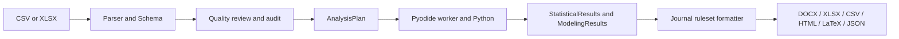

This document explains EasyTableOne's browser-side architecture and data flow.
It describes release v3.40 (Phase 51 Round 3 Part A).

# Architecture

## Seven-step pipeline

1. **Read input:** `src/core/parser/` parses CSV/XLSX into a `DataFrame`.
2. **Infer and review schema:** `src/core/schema/` and `src/ui/pages/SchemaStage.tsx` describe columns and levels.
3. **Quality review:** `src/core/qa/` checks data and records user decisions.
4. **Plan analysis:** `src/core/stats/` selects methods from the schema, plan, and rules.
5. **Compute:** `src/workers/pyodide.client.ts` sends work to `pyodide.worker.ts`, which calls Python in `src/workers/python/`.
6. **Format:** `src/core/format/` creates `FormattedTable` using the selected journal ruleset.
7. **Export:** `src/core/export/` builds documents, flat files, reports, and reproducibility records.

The React application and export builders run on the main thread. The module Web Worker owns Pyodide and scientific computation. The client sends `{ id, fnName, args }`; the worker replies `{ id, result }` or `{ id, error }`. Special calls are `ping` → `"pong"`, `check_ready` → `true`, `getMemoryStats` → `{ wasmBytes }`, and `run_python` → the converted Python result. Other names resolve to Python globals and receive positional `args`.

## Data model

| Model | Schema | Purpose; producer → consumer |
|---|---|---|
| `Schema` | `src/core/types/index.ts` (`SchemaSchema`) | Column types, labels, levels and exclusion metadata; inference → QA, planning, statistics, exports. |
| `AnalysisPlan` | `src/core/types/index.ts` (`AnalysisPlanSchema`) | Grouping, variables, tests, overrides and audit history; plan UI → statistics, worker and export. |
| `StatisticalResults` | `src/core/types/index.ts` (`StatisticalResultsSchema`) | Group summaries, tests, p values and metadata; worker → preview, formatter, reports. |
| `JournalRuleset` | `src/core/types/index.ts` (`JournalRulesetSchema`) | Versioned formatting policy from `journal_rulesets.json`; formatter and exports consume it. |
| `FormattedTable` | `src/core/types/index.ts` (`FormattedTableSchema`) | Header, rows, notes and methods; formatter → DOCX, XLSX, CSV, LaTeX, HTML and JSON. |
| `ModelingResults` | `src/core/modeling/types.ts` (`ModelingResults` TypeScript interface; no Zod runtime schema exists) | Logistic and ML estimates, validation, diagnostics and curves; modeling worker → reports and reproducibility JSON. |
| `AuditEntry` | `src/core/types/index.ts` (`AuditEntrySchema`) | Timestamped action and details; workflow → analysis plan and reproducibility record. |

## Export paths

`formatTable` turns results, schema, plan and the selected ruleset into `FormattedTable`.

| Builder | Output | Input |
|---|---|---|
| `exportDocx` in `src/core/export/docx.ts` | DOCX Blob | Formatted table, optional plots, EDA/modeling and educational reports. |
| `exportXlsx` in `src/core/export/xlsx.ts` | XLSX Blob | Formatted table. |
| `exportCsv` in `src/core/export/csv.ts` | CSV text | Formatted table. |
| `exportLatex` in `src/core/export/latex.ts` | LaTeX text | Formatted table. |
| `HtmlPreview` in `src/core/export/htmlPreview.tsx` | HTML table view | Formatted table. |
| `generateReproducibilityJson` in `src/core/export/reproducibilityJson.ts` | Aggregate-only JSON | Plan, schema, aggregate results, formatted table and optional modeling. |
| `generateAnalysisHistory` in `src/core/export/analysisHistory.ts` | Python script | Plan, schema, results and source-file metadata. |

Other report builders consume aggregate results, model output, optional plots, and audit metadata.
